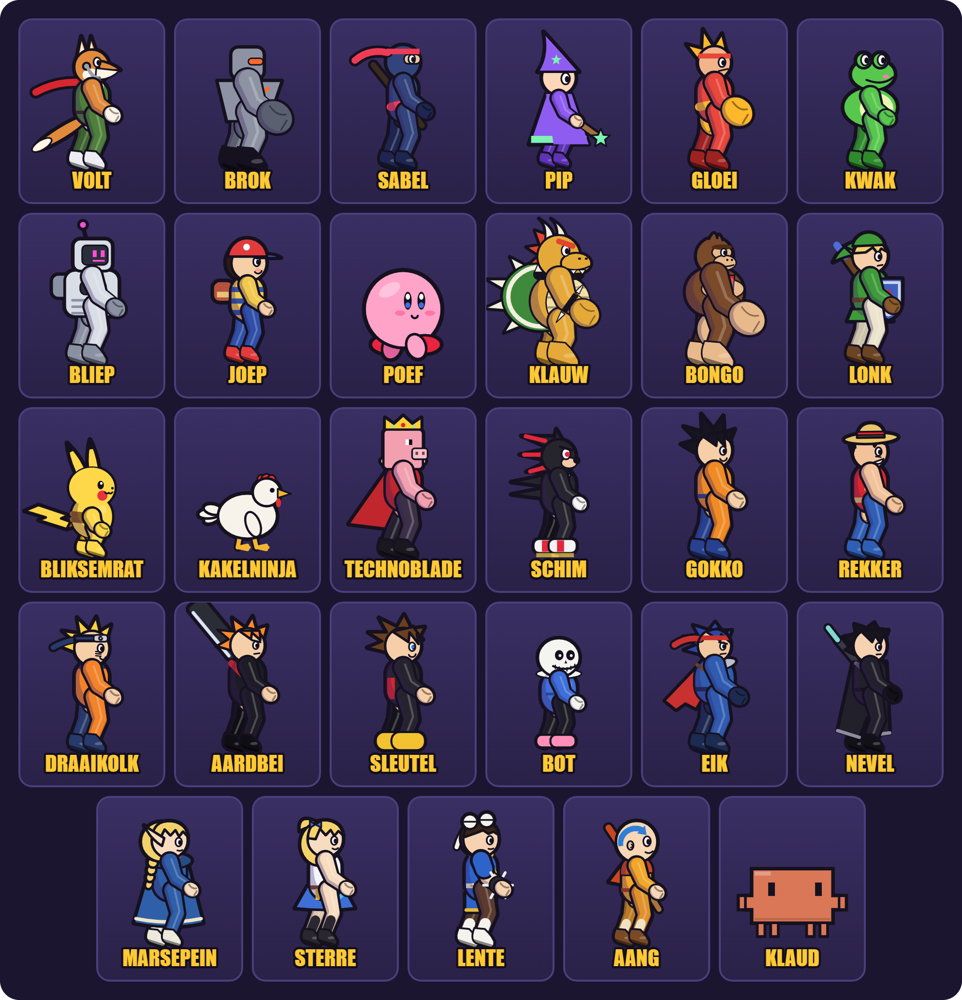

# Klapstuk

Een platformvechter voor 2 tot 4 spelers in de browser: dertig vechters in elk zes kleuren en elk met een eigen taunt, twintig podia (twaalf rustige, waarvan vijf grote met schuine vlakken, muren, een tunnel, een lopende band en schommelende ra's, en acht met gevaren zoals lava, bliksem, een sloopkogel, een vloedgolf, een mijnkar en een pollepel die door een pan hutspot roert), items die je stuk voor stuk aan of uit zet, een Klapbal waarmee elke vechter een eigen final smash doet, een verhaalmodus in acht hoofdstukken, een doelwittenkamer, een baasgevecht tegen Master Voet, achtergrondmuziek (75 nummers die de browser zelf speelt, zonder geluidsbestanden) en CPU-tegenstanders van niveau 1 tot 12. Speel lokaal op één toetsenbord of gamepad, of online met vrienden.

Het spel is één bestand: `index.html`. De WebRTC-bibliotheek zit erin en het spel gebruikt alleen standaardlettertypen (Impact en het systeemlettertype); de pagina laadt niets van andere websites. Er is geen bouwstap en geen eigen server nodig. Daarnaast staat er een `tierlijst.html`, waar het menu naar linkt: welke vechters in CPU-toernooien het vaakst winnen. Ook die is los te openen en laadt niets van buiten. (De afbeelding in `docs/` hoort alleen bij deze uitleg.)

## De vechters



## Spelen

- Kies op elke spelerkaart een besturing: **Toetsenbord 1**, **Toetsenbord 2**, **Gamepad 1**, **Gamepad 2**, **Aanraakscherm**, **CPU** of **Uit**. CPU-tegenstanders hebben een niveau van 1 tot 12.
- Elke speler kiest een vechter met een eigen cursor: de richtingtoetsen bewegen, **aanval** kiest en **speciaal** wisselt van kleur. Met de muis klik je eerst op een spelerkaart en dan op een vechter. Twee spelers met dezelfde vechter krijgen nooit dezelfde kleur.
- Kies een podium uit de twaalf rustige of de zeven met gevaren, of laat het spel er een uit een van beide groepen kiezen. Onder de podia kies je het nummer dat erbij speelt (of laat het willekeurig) en met **Luister** hoor je het alvast.
- Rechts stel je het aantal levens in (1 tot 9), zet je items aan of uit en kies je welke: bom, hartje, knuppel, straalpistool, bananenschil, ster, veer, kist en de Klapbal. Daaronder staan de volumes van muziek en effecten. Met **N** zet je de muziek aan of uit, ook tijdens een gevecht.
- **Taunt**: met **E** (toetsenbord 1), **Numpad 5** of **;** (toetsenbord 2), **Select** of een stick indrukken (gamepad) of **Pose** (aanraakscherm) doet je vechter op de grond een eigen taunt, met een tekstballon: Klaud vraagt of hij het zal samenvatten, Bongo trommelt op zijn borst, Marsepein laat bloemen groeien. CPU's taunten soms na een KO.
- De vijf grote podia: **Bergpas** (een hoger middenstuk met schuine steigers), **Fabriek** (machines als muren, een lopende band die van richting wisselt, steile hellingen en liften), **Boomhut** (de stam is een muur; klim via schuine takken naar de hut), **Piratenschip** (een verhoogd achter- en voordek en ra's die meedeinen) en **Koningsslot** (een tunnel onder een schuin kasteeldak en een toren om te beklimmen).

## Online zetten

Kies één van deze manieren. Alle drie zijn gratis.

**Netlify Drop (snelst, zonder account)**
1. Ga naar https://app.netlify.com/drop
2. Sleep de map `klapstuk-web` in het venster.
3. Je krijgt meteen een adres zoals `https://iets-willekeurigs.netlify.app`.

**GitHub Pages**
1. Maak een nieuwe, openbare repository en zet `index.html` erin.
2. Ga naar *Settings → Pages*, kies de branch `main` en de map `/ (root)`.
3. Na een minuut staat de site op `https://<gebruikersnaam>.github.io/<repository>/`.

**Cloudflare Pages**: maak een project via *Upload assets* en upload de map.

Lokaal testen kan ook. Open `index.html` niet als bestand, maar start een kleine server in deze map:

```bash
python -m http.server 8000
```

Ga daarna naar http://localhost:8000.

## Training, solomodi, replays en toetsen

- **Training: bokszak** (in het menu) zet je eerste menselijke speler tegenover een bokszak, met onbeperkt levens. Linksboven staan je combo, de beste combo, de laatste klap en welke aanvallen verzwakt zijn door herhaling. In het pauzemenu stel je de zak in: zijn schade vast op 0, 50, 100 of 150% (na elke combo springt hij terug), stilstaan, heen en weer lopen, springen of schild houden (dat slijt dan niet vanzelf, alleen door klappen), welke kant hij op duwt als hij geraakt wordt (DI) en of hij zijn landing opvangt, op de plek of met een rol. Met **R** zet je de zak terug en met **H** toon je raakvlakken.
- **Training: technieken** (in het menu) oefent twaalf gevorderde technieken één voor één: korte sprong met luchtaanval, snel vallen, L-cancel, alles samen (SHFFL), wavedash, opvangen (tech), perfect afweren, smash-DI, overleven met DI, ontwijken, grijpen uit schild en randopties. Voor opvangen, smash-DI en DI sluit een ring zich om je vechter en komt er na een wisselende tijd een klap, elke keer met een iets andere hoek en kracht; voor perfect afweren en ontwijken gooit de zak vuurballen van wisselende snelheid en hoogte. Elke poging krijgt meteen uitleg, tot op het frame ("3 frames te vroeg", "4 frames te laat"); vijf keer goed en de techniek is gehaald, wat je browser onthoudt. Kies een techniek met de cijfertoetsen **1–9**, met **[** en **]** of uit de lijst in het pauzemenu. Een stage met gevaren, wind of ijs wordt hier Hemelruïne, zodat niets de timing verstoort.
- In beide trainingen zet **T** het spel op halve of kwart snelheid, en toont **F** onder het paneel een strook met je knoppen en wat je vechter deed in de laatste seconde, frame voor frame (op telefoons staat die strook standaard uit). Beide staan ook in het pauzemenu. Perfect afweren werkt overal niet meer als je net al je schild had (binnen een kwart seconde), zodat rammen op schild niet helpt.
- **Verhaal: het Gouden Klapstuk** (in het menu): Master Voet steelt het Gouden Klapstuk en jij gaat er met je eigen vechter (die van je eerste menselijke speler) achteraan, in acht hoofdstukken. Tussen de gevechten praten de personages met elkaar; daarna vecht je tegen een of meer CPU's, die samen één team tegen jou vormen, op de grote podia. Hoofdstuk 3 is de doelwittenkamer en het laatste hoofdstuk het gevecht met Master Voet. Verlies je, dan probeer je het hoofdstuk opnieuw. Je browser onthoudt hoe ver je bent, en eerdere hoofdstukken kun je opnieuw spelen.
- **Doelwitten slopen** (in het menu): je eerste menselijke speler staat in een grote kamer vol platforms (schuine, bewegende, schommelende, een pilaar en een tunnel) met dertien doelwitten, waarvan twee bewegen. Sloop ze allemaal zo snel mogelijk; pijltjes aan de rand van het scherm wijzen naar de doelwitten buiten beeld. Val je eraf, dan kom je terug en loopt de klok door. Je browser onthoudt per vechter je snelste tijd.
- **Baas: Master Voet** (in het menu): alle menselijke spelers samen tegen een reuzenvoet in een sok, elke keer in een andere skin (onder meer een kerstsok, een zombievoet, een robotvoet en een regenboogsok), met je gewone aantal levens. Hij stampt neer waar zijn schaduw valt (en stuurt schokgolven over de vloer), schopt laag over het podium (spring als je het uitroepteken ziet), schiet teennagels, laat stinkwolken los en hinkelt op zijn tenen over het podium. Onder 40% wordt hij rood, sneller en stampt hij twee keer. Spelers raken elkaar hier niet. Ook hier onthoudt je browser je snelste tijd.
- **Replays.** Elk gevecht wordt opgenomen, ook online (de solomodi niet). Op het uitslagscherm kies je **Terugkijken** of **Bewaar replay**; dat laatste slaat een klein `.klap`-bestand op (een paar honderd kB voor een gevecht van drie minuten). Met **Replay openen** in het menu speel je zo'n bestand later weer af, met pauze, spoelen en halve of dubbele snelheid. Met **Video** in de replaybalk maak je er een videobestand van om te delen (1280×720 met geluid, mp4 of webm, afhankelijk van de browser): de replay speelt daarvoor één keer in gewone snelheid af, dus laat het tabblad zolang open. Een replay bewaart wat er gebeurde, geen video: als een vechter later anders getekend wordt, zie je dat ook in oude replays.
- Onder **Beeld** (onderaan het menu) zet je **Detail** aan of uit: schaduw, fijnere lijnen, vuisten en schoenen op de vechters. Op telefoons en tablets staat het standaard uit. **Automatisch bijstellen** (standaard aan) houdt in de gaten of het spel tijdens een gevecht beelden mist; hapert het een paar seconden achter elkaar, dan zet het zelf de resolutie lager en daarna Detail uit, en onthoudt dat op dat apparaat. Uit en weer aan zet alles terug. Daar zet je ook een teller aan die tijdens een gevecht onder de pauzeknop laat zien hoeveel beelden per seconde het spel haalt.
- Onder **Besturing en technieken** kun je de toetsen van beide toetsenbord-indelingen aanpassen: klik op een toets en druk de nieuwe. Je instellingen blijven bewaard in je browser.

## Online spelen

1. Zet de schakelaar bovenaan het menu op **Online**, vul je naam in en kies **Nieuw spel hosten**.
2. Stuur de **uitnodigingslink** (of de code van 4 tekens) naar je vrienden. Wie de link opent, doet meteen mee.
3. Iedereen kiest een vechter in hetzelfde rooster als bij lokaal spelen, en een besturing op de eigen spelerkaart. De host kiest het podium, de levens, de items en of lege plekken met CPU's worden gevuld; de anderen zien die keuzes meteen.
4. De host drukt op **Start!**.

Er spelen maximaal 4 mensen. Wie later komt, kijkt mee. Niemand heeft een account nodig.

Alleen de host kan pauzeren, en dan staat het spel voor iedereen stil. In het pauzemenu stuurt de host met **Iedereen naar lobby** alle spelers terug naar de lobby voor een nieuwe ronde; met **Spel opheffen** sluit de host het spel. Een gast kan het spel daar verlaten.

## Hoe de verbinding werkt

- De browsers verbinden rechtstreeks met elkaar via **WebRTC**, met de bibliotheek [PeerJS](https://peerjs.com) 1.5.4 (MIT-licentie, ingebouwd in `index.html`).
- Om elkaar te vinden gebruiken ze de **gratis openbare signaleringsserver van PeerJS** (`0.peerjs.com`). Daarna loopt het spelverkeer direct tussen de spelers.
- De **host** draait het echte spel en stuurt ongeveer 30 keer per seconde de stand naar de gasten. Gasten sturen alleen hun knoppen. Houd als host het tabblad op de voorgrond: browsers vertragen tabbladen op de achtergrond.
- Voor het vinden van een route door routers gebruikt het spel de STUN-servers van Google en Cloudflare.
- Is er een **TURN-server** ingesteld (zie hieronder), dan stuurt die het verkeer door als een directe verbinding niet lukt.

## TURN-server instellen

Sommige bedrijfs-, school- of mobiele netwerken blokkeren directe WebRTC-verbindingen. Een TURN-server lost dat op door het verkeer door te sturen. De vroegere gratis publieke TURN-servers bestaan niet meer: die van PeerJS (`eu-0`/`us-0.turn.peerjs.com`) hebben geen DNS-record meer, en Open Relay (`openrelay.metered.ca`) is uitgezet. Een TURN-server vraagt dus een eigen (gratis) account.

De instellingen staan bovenaan het script `window.KlapP2P` in `index.html`. Zoek naar `TURN-instellingen` en vul **één** van de twee in.

**Optie 1: Metered (gratis basisabonnement)**
1. Maak een account op https://www.metered.ca/stun-turn en maak een app aan, bijvoorbeeld `klapstuk`.
2. Maak onder *TURN Server → Credentials* een API-sleutel aan.
3. Vul het adres in dat Metered geeft:
   ```js
   const TURN_CREDENTIALS_URL = 'https://klapstuk.metered.live/api/v1/turn/credentials?apiKey=JOUW_SLEUTEL';
   ```

**Optie 2: vaste gegevens** (Metered, ExpressTURN, je eigen coturn-server, …)
```js
const TURN_SERVERS = [{
  urls: ['turn:HOST:80', 'turn:HOST:443?transport=tcp', 'turns:HOST:443?transport=tcp'],
  username: 'NAAM',
  credential: 'WACHTWOORD',
}];
```

Let op: deze gegevens staan leesbaar in een openbare pagina. Iedereen die de bron bekijkt, kan je TURN-tegoed gebruiken. Zet bij je TURN-aanbieder daarom een limiet op het verbruik, en waar dat kan een beperking tot je eigen domein.

## Bekende beperkingen

- **Gratis signaleringsserver.** De openbare PeerJS-server heeft geen garantie op beschikbaarheid. Ligt hij plat, dan kun je wel lokaal spelen maar geen nieuwe online spellen starten. Je kunt een eigen [PeerServer](https://github.com/peers/peerjs-server) draaien en `host`, `port` en `path` toevoegen aan `PEER_OPTS` in het script `window.KlapP2P`.
- **Vertraging.** Gasten zien het spel een paar frames later dan de host, en hun invoer reist eerst naar de host. Bij veel afstand of een trage verbinding voelt een gast dat.
